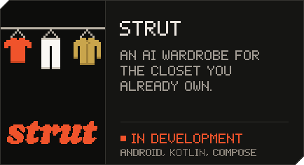
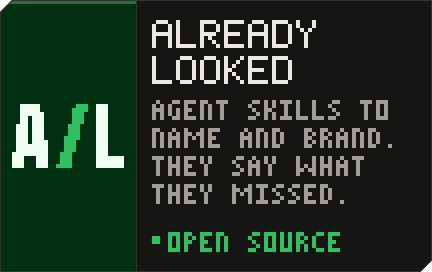

  

  

  <a href="https://rippersgames.com">rippersgames.com</a> &nbsp; <a href="https://x.com/juztripper">x</a> &nbsp; <a href="https://juztripper.itch.io">itch.io</a>

<!-- every image here is ascii: art/gen.py rasterizes each project's logo into characters and writes the animated svgs. -->
