 

  i make games and the tools around them. started on roblox at 9, one of my games peaked at 7,000 players, and i never really stopped. 
  self-taught: i learn things by saying them back in my own words. building from portugal as <a href="https://rippersgames.com">ripper's games</a>.

  <a href="https://rippersgames.com">rippersgames.com</a> &nbsp;·&nbsp;
  <a href="https://x.com/juztripper">x / @juztripper</a> &nbsp;·&nbsp;
  <a href="https://woolgathering.app">woolgathering.app</a>

 

  

  
  
  
  
  
  

 

  

<!-- all art is hand-coded svg, generated by art/*.mjs. the voyage log redraws itself daily (.github/workflows/voyage.yml). -->
